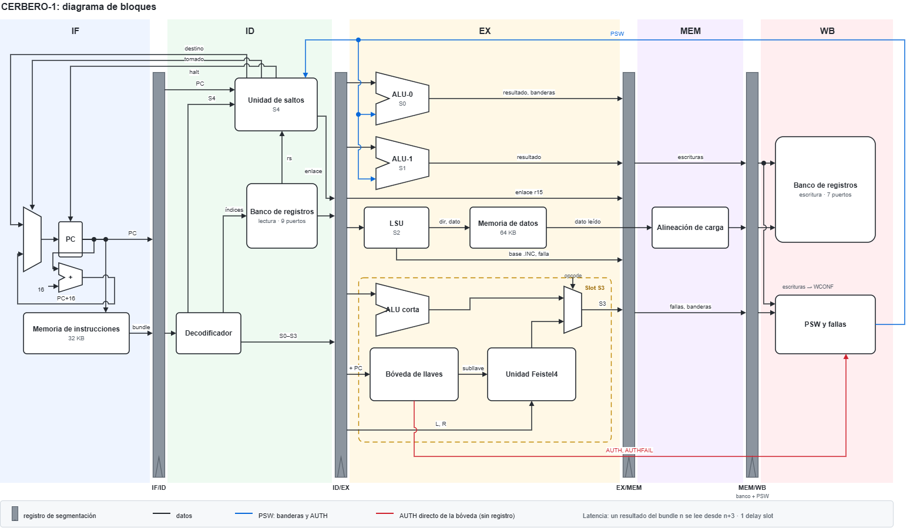

# Microarquitectura de CERBERO-1

Este documento explica cómo está construido por dentro el procesador que vive en `src/cpu/`: qué piezas lo forman, cómo se conectan y cómo avanza una instrucción desde que se lee de memoria hasta que deja su resultado. También explica por qué cada pieza está hecha como está.

---

## 1. Visión general

CERBERO-1 es un procesador diseñado para este proyecto. Corre programas de propósito general (aritmética, comparaciones, ciclos, accesos a memoria) y además tiene dos piezas especiales para cifrar datos:

- una unidad criptográfica que ejecuta en un solo paso una ronda del cifrado del algoritmo de Feistel4;
- una bóveda de llaves, una caja fuerte de hardware que guarda las llaves de cifrado sin que ningún programa pueda leerlas.

### 1.1 Cinco instrucciones por ciclo

CERBERO-1 es un procesador VLIW (Very Long Instruction Word). En un procesador común, cada instrucción hace una sola cosa. Aquí, en cada ciclo de reloj se lee un bundle; un paquete de 128 bits que trae cinco instrucciones, y las cinco se ejecutan al mismo tiempo.

Cada posición dentro del bundle se llama slot, y cada slot va siempre a la misma unidad funcional (la pieza de hardware que ejecuta esa instrucción):

| Slot | Bits del bundle | Unidad | Para qué sirve | Ejemplo |
| :---: | :---: | :--- | :--- | :--- |
| S0 | `[127:96]` | ALU-0 | Aritmética, lógica y comparaciones | `add r1, r2, r3` |
| S1 | `[95:64]` | ALU-1 | Lo mismo que ALU-0, menos comparar | `addi r4, r4, #8` |
| S2 | `[63:32]` | LSU | Leer y escribir la memoria de datos | `lw r6, #0(r7)` |
| S3 | `[31:16]` | Cripto, bóveda o ALU corta | Una ronda de cifrado, manejar llaves, o una operación simple | `f4e p5, k0, #0` |
| S4 | `[15:0]` | BRU | Saltos y llamadas | `br.ne lazo` |

En ensamblador, un bundle se escribe en una línea, con los slots separados por
`|`:

```
add r1, r2, r3 | addi r4, r4, #8 | lw r6, #0(r7) | f4e p5, k0, #0 | br.ne lazo ;
```

La característica central de un VLIW es que el hardware no revisa nada. No reordena instrucciones ni detecta si una necesita el resultado de otra. Esa responsabilidad es de quien escribe el programa (el programador o el compilador). A cambio, el hardware es simple y rápido. La sección 3 explica las reglas concretas que el programa debe respetar.

### 1.2 Unidades Funcionales y componentes adicionales del procesador VLIW 

El procesador tiene siete unidades funcionales más las piezas que las
alimentan:

| Pieza | Archivo | Qué hace |
| :--- | :--- | :--- |
| Contador de programa | `fetch.sv` | Guarda la dirección del bundle actual (el PC o Program Counter) y decide cuál es el siguiente |
| Memoria de instrucciones | `imem.sv` | Guarda el programa: 2048 bundles (32 KB) |
| Despacho | `dispatch.sv` | Separa el bundle en sus cinco instrucciones |
| Banco de registros | `regfile.sv` | Los 16 registros de 32 bits (`r0` a `r15`) |
| ALU-0 y ALU-1 | `alu.sv` | Operaciones aritméticas y lógicas |
| LSU | `lsu.sv`, `load_align.sv` | Accesos a la memoria de datos |
| Memoria de datos | `dmem.sv` | 64 KB para los datos del programa |
| Unidad Feistel4 | `crypto_unit.sv` | Una ronda del cifrado |
| Bóveda de llaves | `key_vault.sv` | Guarda las llaves y controla quién puede usarlas |
| ALU corta | `short_alu.sv` | Operaciones simples en el slot S3 cuando no se cifra |
| BRU | `bru.sv` | Saltos |
| Registro de estado | `psw_fault_unit.sv` | El PSW, banderas de comparación, estado de la bóveda y registro de fallas |
| Procesador completo | `top.sv` | Conecta todo lo anterior |

Hay dos memorias separadas, una para instrucciones y otra para datos. A esto se le llama arquitectura Harvard. Se eligió porque un bundle mide 128 bits y un dato 32, y una sola memoria tendría que servir los dos anchos, lo cual técnicamente es más complejo por lo que se decidió separar ambas.

### 1.3 Diagrama de bloques


### 1.3 Diagrama de bloques



El diagrama se lee de izquierda a derecha, en el orden en que un bundle avanza por las cinco etapas. Las barras grises son las fronteras entre etapas: IF/ID, ID/EX y EX/MEM son registros de segmentación, y MEM/WB la forman el propio banco de registros y el PSW, que escriben en el flanco que abre WB.

- **IF:** el PC elige entre el bundle siguiente (PC + 16) y el destino de un
  salto, y lee el bundle de la memoria de instrucciones.
- **ID:** el decodificador separa los cinco slots, el banco lee los registros y
  la unidad de saltos decide si saltar.
- **EX:** trabajan en paralelo las dos ALU, la LSU con la memoria de datos, y en
  el slot S3 una de tres unidades: la ALU corta, o la bóveda junto con la unidad
  Feistel4.
- **MEM:** la alineación de carga extrae el dato leído de la memoria.
- **WB:** se escriben el banco de registros y el PSW.

Las líneas negras son datos. La azul es el PSW, que vuelve a la unidad de saltos y a las ALU. La roja es `AUTH`, que va directo de la bóveda al PSW sin pasar por registros.


---

## 2. El pipeline

Un bundle no se procesa de una sola vez, pasa por cinco etapas, una por ciclo de reloj, como un producto en una línea de ensamblaje, es decir se implementa la técnica de ILP conocida como Pipeline, en este caso se decidió desarrollar un pipeline clásico de solo 5 etapas.

| Etapa | Nombre | Qué le pasa al bundle | Piezas que trabajan |
| :---: | :--- | :--- | :--- |
| IF | Buscar | Se lee de la memoria de instrucciones | `fetch`, `imem` |
| ID | Decodificar | Se separa en sus cinco instrucciones, se leen los registros que necesitan y, si trae un salto, se decide si saltar | `dispatch`, `regfile` (lectura), `bru` |
| EX | Ejecutar | Las unidades funcionales trabajan en paralelo: suman, cifran, calculan direcciones de memoria | `alu` ×2, `lsu`, `key_vault`, `crypto_unit`, `short_alu`, `dmem` |
| MEM | Memoria | Si hubo una lectura de memoria, se extrae el dato pedido | `load_align` |
| WB | Escribir | Los resultados se guardan en los registros y en el PSW | `regfile` (escritura), `psw_fault_unit` |

Lo que hace útil al pipeline es que las etapas trabajan al mismo tiempo sobre bundles distintos. Mientras un bundle se ejecuta en EX, el siguiente se decodifica en ID y otro más se busca en IF. Así entra un bundle nuevo en cada ciclo:

| Ciclo | 1 | 2 | 3 | 4 | 5 | 6 | 7 |
| :--- | :---: | :---: | :---: | :---: | :---: | :---: | :---: |
| Bundle 1 | IF | ID | EX | MEM | WB | | |
| Bundle 2 | | IF | ID | EX | MEM | WB | |
| Bundle 3 | | | IF | ID | EX | MEM | WB |

En el ciclo 5 hay cinco bundles distintos dentro del procesador, uno en cada
etapa. El pipeline nunca se detiene, pues como se menciono anteriormente el compilador o programador son los responsables de tener bundles que no dependan los unos de los otros, por lo que el procesador no debe manejar hazards y no hay ninguna situación en la que una etapa tenga que esperar a otra.

### 2.1 Cómo pasa un bundle de una etapa a la siguiente

Entre dos etapas hay un registro de segmentación, un conjunto de biestables (celdas de memoria de un bit) que, en cada flanco de reloj, guarda todo lo que el bundle lleva consigo y se lo entrega a la etapa siguiente. Gracias a eso, cada etapa puede trabajar sobre su propio bundle sin mezclarse con las demás.

| Entre | Lo implementa | Qué lleva |
| :--- | :--- | :--- |
| IF - ID | La salida de `imem` y `reg_if_id.sv` | El bundle, su PC y si es válido |
| ID - EX | `reg_id_ex.sv` | Las instrucciones de S0 a S3, los 9 valores leídos de los registros, el PC, y lo que ya resolvió la BRU |
| EX - MEM | `reg_ex_mem.sv` y la salida de `dmem` | Las 7 escrituras pendientes, las fallas de cada slot, las banderas de ALU-0 |
| MEM - WB | (no hace falta) | El banco y el PSW escriben directamente al empezar WB |

Dos de estas fronteras no son un módulo aparte, sino la propia memoria. Las memorias de CERBERO-1 son síncronas, reciben la dirección en un flanco de reloj y entregan el dato guardado en un registro interno, estable durante todo el ciclo siguiente. Ese registro interno ya cumple la función de registro de segmentación, así que no hace falta otro.

La señal `valid` viaja con cada bundle e indica si es un bundle real. Vale cero durante el reset y después de `HALT`, para que las unidades no ejecuten basura ni reporten fallas falsas.

### 2.2 Flancos de reloj

Cada ciclo de reloj tiene dos instantes en los que un circuito puede guardar un valor: el flanco de subida (posedge, cuando el reloj pasa de 0 a 1) y el flanco de bajada (negedge, de 1 a 0, a mitad del ciclo). Las piezas de CERBERO-1 usan uno u otro a propósito:

| Pieza | Lee en | Escribe en | Por qué |
| :--- | :--- | :--- | :--- |
| Banco de registros | Bajada | Subida | Un resultado que se escribe al inicio de un ciclo ya se puede leer a mitad del mismo ciclo. Esto ahorra un ciclo de espera (sección 3) |
| Memoria de instrucciones | Subida | (no se escribe) | Su salida es la frontera IF - ID |
| Memoria de datos | Subida | Bajada | Su salida es la frontera EX - MEM. Además, leer y escribir nunca ocurren en el mismo instante |
| Bóveda | En cualquier momento | Subida | Una operación ve el estado que había antes de su bundle |
| Registro de estado | En cualquier momento | Subida | Escribe junto con el banco, en WB |

"En cualquier momento" significa que la salida es combinacional y depende directamente de las entradas, sin esperar un flanco.

Todos los registros se reinician con la señal `rst_n` (activa en bajo) en un flanco de subida.

---

## 3. Resultado de un bundle 

La regla principal que debe respetar un programa es:

> Un resultado producido en el bundle `n` se puede usar desde el bundle `n + 3`.

Si el bundle `n + 1` o el `n + 2` leen ese registro, obtienen el valor viejo. El hardware no lo detecta ni espera: quien escribe el programa debe dejar dos bundles de por medio. Esos bundles no tienen que ir vacíos, pueden traer trabajo que no dependa del resultado. Llenarlos bien es lo que hace rápido a un programa VLIW.

```
add r6, r7, r8 | ... ;    // bundle n: produce r6
...            | ... ;    // n+1: todavía no puede leer r6
...            | ... ;    // n+2: todavía no puede leer r6
sub r9, r6, r7 | ... ;    // n+3: ya ve el r6 nuevo
```

El número de 3 sale de dónde se escribe y dónde se lee cada registro. Si el bundle `n` se busca en el ciclo `n`:

| Momento | Ciclo |
| :--- | :---: |
| El productor está en EX y calcula el resultado | `n + 2` |
| El productor está en MEM | `n + 3` |
| El banco guarda el resultado (flanco de subida al empezar WB) | inicio de `n + 4` |
| Un consumidor `m` lee el registro en ID (flanco de bajada) | mitad de `m + 1` |

El consumidor ve el valor nuevo si lee después de que se guardó, es decir, si `m + 1 ≥ n + 4`, o sea `m ≥ n + 3`.

El número es el mismo para todas las unidades porque todas escriben por el mismo camino: el resultado viaja por los registros de segmentación y se guarda en WB. Esto incluye a las ALU, las lecturas de memoria, las rondas de cifrado, la dirección de retorno de un salto y las banderas de una comparación. Tener una sola regla para todo es lo que hace simple el trabajo del compilador.

El caso más llamativo es la dirección de retorno de `JAL`: la BRU ya la tiene calculada en ID, tres etapas antes de WB, y aun así se retrasa hasta WB. Si se escribiera antes, habría que agregar una excepción a la regla.


## 4. Saltos

### 4.1 El delay slot

Los saltos se deciden en ID, lo antes posible. Pero cuando el salto llega a ID, la etapa IF ya está buscando el bundle que sigue en memoria:

| Ciclo | IF busca | ID tiene |
| :---: | :--- | :--- |
| `n` | El salto | |
| `n + 1` | El bundle siguiente | El salto: la BRU decide |
| `n + 2` | El destino del salto | El bundle siguiente |

En vez de desechar ese bundle siguiente, el procesador lo ejecuta siempre, se tome el salto o no. Ese bundle se llama delay slot. Como nunca se busca un bundle que haya que descartar, ninguna etapa necesita lógica para vaciarse:
el siguiente PC es simplemente el destino si se salta, o el bundle contiguo (PC + 16) si no.

Decidir el salto en EX habría dejado dos bundles en camino, así que habría hecho falta tener dos delay slots, o agregar lógica para vaciar el pipeline.

La BRU es combinacional, lee las banderas del PSW y, en `JR` y `JALR`, el registro con la dirección de destino, y le entrega a `fetch` tres señales antes del flanco: si se salta (`taken`), a dónde (`target`) y si hay que detenerse (`halt`).

Las direcciones de un salto se calculan así:

- Destino relativo (`BR`, `JAL`): `PC + (desplazamiento + 1) × 16`. El
  desplazamiento se cuenta en bundles a partir del bundle que sigue al salto.
- Dirección de retorno (`JAL`, `JALR`): `PC + 32`, el bundle que viene
  después del delay slot. Se guarda en `r15` solo si el salto se toma.

### 4.2 `HALT`

`HALT` detiene el procesador y se comporta como un salto: su delay slot también se ejecuta. Desde el ciclo siguiente, `fetch` deja de avanzar el PC, baja `valid` y activa la salida `halted`. Los bundles que ya estaban dentro del pipeline terminan normalmente.

### 4.3 Saltos a una dirección en registro

`JR` y `JALR` saltan a la dirección guardada en un registro, que puede traer cualquier valor. Como cada bundle ocupa 16 bytes, una dirección válida termina en cuatro bits en cero. `fetch` fuerza esos cuatro bits a cero, de modo que el
procesador salta al bundle que contiene esa dirección. Un destino mal alineado no se reporta como falla.

---

## 5. Despacho o separación del bundle

En ID, `dispatch.sv` hace dos cosas, para los cinco slots a la vez:

1. Separa los 128 bits del bundle en las cinco instrucciones, según los
   rangos de bits de la tabla de la sección 1.1.
2. Decide qué registros hay que leer. El banco tiene 9 puertos de
   lectura, 9 entradas por las que se pide un registro y 9 salidas por las
   que sale su valor, todas en el mismo ciclo. `dispatch` le dice a cada
   puerto qué registro leer:

| Puerto | Slot | Lee normalmente | Excepción |
| :---: | :---: | :--- | :--- |
| `RP_S0_A` | S0 | Primer operando (`rs1`) | `MOVH` lee el destino `rd`, porque conserva su mitad baja |
| `RP_S0_B` | S0 | Segundo operando (`rs2`) | |
| `RP_S1_A` | S1 | Primer operando | Igual que S0 |
| `RP_S1_B` | S1 | Segundo operando | |
| `RP_S2_A` | S2 | Registro base de la dirección | |
| `RP_S2_B` | S2 | Dato a guardar (en un store) | |
| `RP_S3_A` | S3 | Registro de la ALU corta o de la bóveda | `F4E`/`F4D` leen la mitad L del par |
| `RP_S3_B` | S3 | Segundo operando de la ALU corta | `F4E`/`F4D` leen la mitad R del par |
| `RP_S4` | S4 | Dirección de destino de `JR`/`JALR` | |

Un par de registros es lo que usan las instrucciones de cifrado: el par `p5` son los registros `r10` y `r11` (en general, `pN` son `r(2N)` y `r(2N+1)`). Un bloque de 64 bits se cifra como dos mitades de 32 bits, L y R.

Si una instrucción no usa un puerto, este lee igual lo que diga el campo correspondiente y el valor simplemente no se usa. Leer un registro no tiene efectos secundarios, y así la lógica de cada puerto queda mínima.

No existe una unidad de control central: cada unidad funcional interpreta su
propia instrucción. En esta ISA la posición del slot ya dice a qué unidad va la instrucción, así que no hay nada que repartir. Por la misma razón, `dispatch` no detecta instrucciones inválidas; lo hace cada unidad, que de todos modos necesita saberlo para anular su resultado.

---

## 6. Las unidades funcionales

Todas las unidades, excepto la BRU, trabajan en EX. Todas son combinacionales: calculan su resultado a partir de sus entradas sin guardar nada. Reciben su instrucción y los valores ya leídos de los registros, y entregan tres cosas: qué registro escribir, el valor, y si hubo una falla.

| Unidad | Slot | Qué hace | Fallas que detecta |
| :--- | :---: | :--- | :--- |
| ALU-0 | S0 | Aritmética, lógica, desplazamientos, multiplicación, comparaciones. Es la única que escribe las banderas | Instrucción inválida |
| ALU-1 | S1 | Lo mismo que ALU-0, sin comparaciones | Instrucción inválida |
| LSU | S2 | Lee y escribe bytes, medias palabras y palabras en la memoria de datos | Instrucción inválida, dirección mal alineada, dirección fuera de rango |
| Unidad Feistel4 | S3 | Una ronda de cifrado (`F4E`) o descifrado (`F4D`) sobre un par | Ninguna: la revisa la bóveda |
| Bóveda | S3 | Guarda llaves, controla el acceso, entrega la subllave de cada ronda | Instrucción inválida, acceso denegado, llave vacía |
| ALU corta | S3 | 8 operaciones simples de la forma `rd ← rd op x` | Instrucción inválida |
| BRU | S4 | Saltos condicionales e incondicionales, llamadas, `HALT` | Instrucción inválida |

### 6.1 Las dos ALU

ALU-0 y ALU-1 son el mismo módulo (`alu.sv`) instanciado dos veces. Un
parámetro, `IS_SLOT0`, indica cuál es cuál. Solo ALU-0 escribe las banderas, para que nunca haya dos instrucciones del mismo bundle compitiendo por ellas; una comparación puesta en S1 se considera inválida.

La ALU es la única unidad que no recibe la señal `valid`, así que `top.sv` bloquea sus escrituras cuando el bundle no es válido. Sin eso, durante el reset o después de `HALT` la ALU escribiría registros con basura.

### 6.2 La LSU trabaja en dos etapas

La LSU es la única unidad que necesita dos etapas. En EX calcula la dirección (registro base + desplazamiento) y se la entrega a la memoria de datos. El dato leído recién está disponible en MEM, y ahí `load_align.sv` extrae la parte que pidió la instrucción: el byte, la media palabra o la palabra completa, y le extiende el signo si corresponde.

La dirección no pasa por un registro de segmentación antes de llegar a la memoria, la LSU la calcula en EX y la memoria la toma en el flanco de subida que separa EX de MEM. Si la dirección se guardara primero en el registro EX - MEM, la memoria la recibiría un ciclo más tarde, el dato saldría en WB y un load tardaría 4 bundles en vez de 3. Eso rompería la regla única de la
sección 3. Las escrituras ni siquiera llegan a MEM: la memoria las guarda en el flanco de bajada, a mitad de EX.

Por eso `load_align.sv` es un módulo aparte, que se usa dos veces: dentro de la LSU (para probarla sola) y en la etapa MEM del procesador. Así la tabla de tamaños y signos existe en un solo lugar.

Al escribir, la LSU copia el dato en los cuatro bytes de la palabra y le dice a la memoria cuáles de esos bytes guardar realmente (una máscara de bytes). La memoria guarda solo los marcados. El orden de bytes es little-endian, el byte de la dirección más baja va en los bits menos significativos.

La LSU revisa tres cosas, en este orden: que la instrucción sea válida, que la dirección esté alineada (una palabra de 4 bytes debe empezar en una dirección múltiplo de 4, una media palabra en una múltiplo de 2) y que la dirección exista en la memoria.

### 6.3 Slot S3: tres unidades en un slot

El slot S3 lo comparten la unidad Feistel4, la bóveda y la ALU corta. Los tres bits más altos del slot (el opcode) deciden cuál actúa, así que en cada bundle trabaja una sola:

| Opcode | Instrucción | Quién actúa |
| :---: | :--- | :--- |
| `000` | NOP (nada) | Ninguna |
| `001`, `010` | `F4E`, `F4D` | La bóveda entrega la subllave y el permiso; la unidad Feistel4 calcula la ronda |
| `011`, `100`, `101` | `KSETW`, `AUTHW`, `VCTL` | La bóveda |
| `110` | Operación de ALU corta | La ALU corta |
| `111` | Reservado | Ninguna: `top.sv` lo registra como instrucción inválida |

En una ronda de cifrado, la bóveda elige la subllave según la llave y la ronda que indica la instrucción, revisa que haya permiso y produce una señal `grant` ("permitido"). La unidad Feistel4 solo calcula la ronda, y escribe el resultado si `grant` está activo. La función de ronda es la del enunciado:

`F(x, k) = (ROL32(x, 5) + k) XOR ROL32(x, 13)`

donde `ROL32(x, n)` rota los 32 bits de `x` `n` posiciones a la izquierda.

### 6.4 Lo que resuelve `top.sv`

`top.sv` es casi todo conexiones entre módulos, pero resuelve algunas cosas que ninguna unidad puede resolver sola, porque involucran a varias:

- Bloquear la ALU: cuando el bundle no es válido.
- Elegir quién escribe en S3: La ALU corta y la unidad Feistel4 usan los
  mismos puertos de escritura del banco; `top.sv` elige según el opcode.
- Marcar el opcode `111` de S3: como instrucción inválida, porque ninguna de
  las tres unidades lo reconoce.
- Avisarle a la bóveda si falló otro slot: del mismo bundle, para que cierre
  la sesión.
- Poner el dato leído de memoria: en la escritura pendiente de la LSU
  durante MEM, porque en EX todavía no existía.

---

## 7. Banco de registros

El banco tiene 16 registros de 32 bits, de `r0` a `r15`. A diferencia de otras arquitecturas como RISC-V, `r0` es un registro normal, no vale siempre cero.

Como un bundle trae cinco instrucciones, el banco necesita atender muchas lecturas y escrituras en el mismo ciclo. Tiene 9 puertos de lectura y 7 puertos de escritura, uno por cada cosa que un bundle puede escribir:

| Puerto | Qué escribe |
| :---: | :--- |
| 0 | Resultado de ALU-0 |
| 1 | Resultado de ALU-1 |
| 2 | Dato leído de memoria |
| 3 | Registro base de `LW.INC`/`SW.INC` (que avanza el puntero después del acceso) |
| 4 | Mitad L del par cifrado, o resultado de la ALU corta |
| 5 | Mitad R del par cifrado |
| 6 | Dirección de retorno en `r15` |

Con un puerto para cada uso, ningún slot tiene que esperar a otro.

Si dos puertos escriben el mismo registro en el mismo ciclo, gana el de número menor, que corresponde al slot de número menor. Esto resuelve también el único caso permitido dentro de un mismo slot: un `LW.INC` cuyo destino es su
propio registro base. Ahí gana el dato leído (puerto 2) sobre el puntero incrementado (puerto 3).


---

## 8. Fallas y registro de estado

### 8.1 Anular y marcar

CERBERO-1 no tiene interrupciones. Cuando una instrucción no se puede ejecutar, se aplica una política llamada "anular y marcar"

- Anular: la unidad que detectó el problema no escribe nada, ni en
  registros ni en memoria.
- Marcar: la causa queda registrada en el PSW.

Las otras cuatro instrucciones del bundle se ejecutan normalmente y el programa sigue. Si quiere saber si algo falló, lo consulta con la instrucción `MFPSW`.

Las causas posibles son:

| Causa | Significado |
| :--- | :--- |
| `ILLOP` | Instrucción inválida o con bits reservados distintos de cero |
| `MISALIGN` | Acceso a memoria mal alineado |
| `RANGE` | Dirección de memoria que no existe |
| `DENIED` | Operación con la bóveda sin permiso |
| `NOKEY` | Cifrado con una llave que no se ha cargado |
| `WCONF` | Dos slots del mismo bundle escribieron el mismo registro |

Cada falla viaja con su bundle por los registros de segmentación y llega al PSW en WB, en el mismo instante en que el banco guarda los resultados. Así una falla y los resultados de su bundle se vuelven visibles a la vez. La falla de
la BRU, que ocurre en ID, se retrasa un ciclo para que viaje junto con las de los demás slots.

### 8.2 `WCONF` se detecta al final

`WCONF` significa que dos slots escribieron el mismo registro. Saber si eso pasó requiere saber qué slots escribieron de verdad, y eso recién se sabe después de EX: un salto solo escribe la dirección de retorno si se toma, un acceso a memoria que falla no escribe, y una ronda de cifrado sin permiso tampoco.

Por eso `psw_fault_unit.sv` lo detecta en WB, mirando las escrituras reales.
Detectarlo antes obligaría a suponer que toda instrucción que podría escribir escribe, y se reportarían conflictos que nunca ocurrieron. Un aviso falso en el PSW es peor que ninguno, porque el programa lo lee y actúa en consecuencia.

### 8.3 El registro de estado (PSW)

| Bits | Campo | Significado | Quién lo escribe |
| :---: | :--- | :--- | :--- |
| 0 | Z | La última comparación dio cero | ALU-0, solo con `CMP`, `CMPI`, `TEST` o `TESTI` |
| 1 | N | Dio negativo | Igual que Z |
| 2 | C | Acarreo o préstamo de la comparación (`TEST` lo deja en cero) | Igual que Z |
| 3 | V | Desborde con signo (`TEST` lo deja en cero) | Igual que Z |
| 4 | `AUTH` | Hay una sesión abierta en la bóveda | La bóveda, directamente |
| 5 | `AUTHFAIL` | El último intento de entrar a la bóveda falló | La bóveda, directamente |
| 6 | `EXC` | Ocurrió alguna falla | `psw_fault_unit` |
| 9:7 | `CAUSE` | Cuál fue la falla | `psw_fault_unit` |
| 31:10 | | Sin uso, se leen como cero | |

`EXC` y `CAUSE` son sticky: una vez encendidos solo se limpian con un reset, y guardan la primera falla. Se eligió la primera porque una falla suele provocar otras después (un dato que no se cargó hace fallar los cálculos siguientes), y la que sirve para depurar es la original. Si fallan varios slots del mismo bundle, se guarda la del slot de número menor.

`AUTH` y `AUTHFAIL` no se guardan en el PSW: son cables que vienen directo de la bóveda. Si el PSW tuviera su propia copia, habría dos registros que tendrían que coincidir siempre, sin garantía de que lo hagan.

---

## 9. La bóveda de llaves

La bóveda (`key_vault.sv`) cumple el papel de raíz de confianza: un lugar en el hardware donde se guardan secretos que el software no puede leer. Guarda:

- 4 llaves de 128 bits. Cada una se divide en 4 subllaves de 32 bits,
  una para cada ronda de Feistel4.
- `KVALID`, que indica qué llaves ya se cargaron completas.
- El secreto de acceso (`ROT_SECRET`), una contraseña de 128 bits grabada
  en el hardware.
- Un registro de desafío, donde el programa escribe la contraseña que
  presenta para entrar.

### 9.1 Por qué la llave no puede salir

La protección no depende de una revisión que podría fallar, sino de cómo está conectada, la bóveda:

- No tiene ningún cable hacia el banco de registros, la LSU ni la memoria de
  datos. Su única salida de datos va a la unidad Feistel4.
- No tiene dirección en el mapa de memoria, así que ninguna lectura de memoria
  la alcanza.
- La unidad Feistel4 usa la subllave internamente y solo escribe el bloque
  cifrado.
- El registro de desafío solo se puede escribir, y se borra después de cada
  intento de entrada.

### 9.2 Cómo se usa la bóveda

Para usar la bóveda, un programa tiene que:

1. **Autenticarse.** Escribe la contraseña de 128 bits en cuatro partes de 32
   bits con `AUTHW`, y pide entrar con `LOGIN`. Si coincide con el secreto del
   hardware, se enciende `AUTH` y se abre una sesión. Si no, se enciende
   `AUTHFAIL`.
2. **Ejecutarse desde la región segura.** Las operaciones con llaves solo
   funcionan si la instrucción está guardada entre las direcciones `0x7000` y
   `0x7FFF` de la memoria de instrucciones.

| Operación | Qué exige |
| :--- | :--- |
| `AUTHW` (escribir contraseña), `LOGIN`, `LOGOUT` | Nada |
| `KSETW` (cargar llave), `PWSET` (cambiar contraseña), `KCLR` (borrar llave), `F4E`, `F4D` (cifrar) | Sesión abierta y estar en la región segura. Si no: `DENIED` |
| `F4E`, `F4D` con una llave que no se cargó | `NOKEY` |

La sesión se cierra sola si:

- falla la propia operación de la bóveda;
- falla cualquier otra instrucción del mismo bundle;
- el programa sale de la región segura.

El cierre automático evita que un programa abra la sesión en código confiable y después salte a código no confiable que la aproveche.

Para meter una llave en la bóveda, el programa primero la arma en registros: `cargar_llave.s` la deja en `r5` a `r8`, y la contraseña está en `r1` a `r4`. Por eso `vault_sesion.s` pone esos ocho registros en cero en los mismos bundles que ejecutan los `KSETW`. Las ALU tienen esos slots libres, así que borrar los registros no cuesta ningún ciclo extra. Desde ese momento ni la llave ni la contraseña quedan en el banco de registros; solo existen dentro de la bóveda.

### 9.3 Decisiones que se tomaron al implementarla

`isa.md` no fijaba algunos detalles, y se resolvieron así:

| # | Decisión |
| :---: | :--- |
| D1 | `AUTHW` indica cuál de las 4 partes de la contraseña escribe en los bits `[10:9]` del slot; los bits `[12:11]` deben ir en cero |
| D2 | `LOGIN`, `LOGOUT` y `PWSET` exigen esos bits `[10:9]` en cero; `KCLR` los usa para indicar qué llave borra |
| D3 | `LOGIN` borra el registro de desafío después de compararlo, entre o no. Así no se puede reintentar sin volver a escribir la contraseña |
| D4 | Un `LOGIN` fuera de la región segura se acepta, pero la sesión se cierra en el mismo instante por estar fuera. En la práctica no abre sesión |
| D5 | Una llave se marca como cargada cuando se escribieron sus 4 subllaves. Reescribir una subllave de una llave cargada la mantiene cargada |
| D6 | `PWSET` toma como contraseña nueva lo que haya en el registro de desafío, y después lo borra |
| D7 | Las operaciones con llaves exigen sesión abierta y estar en la región segura, las dos cosas |
| D8 | Si falla otra instrucción del bundle, la operación de la bóveda igual se ejecuta (cada falla anula solo su propio slot), pero la sesión se cierra |
| D9 | El opcode `111` de S3 lo marca como inválido `top.sv`, no la bóveda |

### 9.4 Cómo se verifica

| Qué se comprueba | Testbench |
| :--- | :--- |
| Cada operación de la bóveda, cada falla, el cierre automático y las decisiones D1 a D9 | `tb_key_vault.sv` |
| La unidad Feistel4 con un modelo de la bóveda | `tb_crypto_unit.sv` |
| La bóveda y la unidad Feistel4 juntas, con las 16 subllaves | `tb_crypto_vault.sv` |
| Una rutina de cifrado en el procesador completo, y la misma rutina rechazada fuera de la región segura | `tb_top.sv`, `tb_asm.sv` |
| Con la contraseña incorrecta no se cifra nada y queda `DENIED` | `tb_credencial.sv` |
| Después de cifrar y descifrar, ninguna subllave aparece en los 64 KB de la memoria de datos | `tb_archivo.sv`, `tb_cifrado.sv`, `tb_descifrado.sv`, `tb_credencial.sv` |
| Una rutina segura que vuelve sin `LOGOUT`: `AUTH` baja sola con el primer bundle fuera de la región, y un `F4E` posterior queda `DENIED` | `tb_programa.sv` con `tools/programas/sesion_sin_logout.s` |
| Después de instalar la llave, `r1` a `r8` quedan en cero | `tb_programa.sv` con los programas que incluyen `vault_sesion.s` |

La búsqueda de subllaves en la memoria tiene un falso positivo conocido: si la llave tiene alguna subllave en cero (por ejemplo, la llave `0000…0000`), la prueba la "encuentra" en cualquier palabra en cero de la memoria y reporta un
error aunque el hardware funcione bien. Con las llaves de prueba normales no ocurre.

---

## 10. Memorias

| | Memoria de instrucciones (`imem.sv`) | Memoria de datos (`dmem.sv`) |
| :--- | :--- | :--- |
| Tamaño | 2048 bundles de 128 bits = 32 KB | 16384 palabras de 32 bits = 64 KB |
| Direcciones | En bytes; cada bundle ocupa 16 | En bytes |
| Acceso | Solo lectura durante la ejecución | Lectura y escritura |
| Dirección inexistente | Devuelve un bundle de ceros, que equivale a cinco NOP | Lectura: devuelve cero. Escritura: se ignora |
| Carga inicial | Desde un archivo `.hex` con `$readmemh` | Igual |

La revisión de direcciones inexistentes en la memoria es una segunda línea de defensa. La primera es la LSU, que detecta la dirección inválida, registra `RANGE` y anula el acceso: una escritura no llega a la memoria y una lectura no escribe ningún registro.

Las direcciones importantes son la región segura (`0x7000`–`0x7FFF` de la
memoria de instrucciones) y la zona de archivos a cifrar, que empieza en `0x4000` de la memoria de datos. El mapa completo está en `isa.md`, sección 1.4.

---

## 11. Riesgos

En un pipeline, un riesgo es una situación en la que un bundle no puede
avanzar correctamente porque depende de otro que todavía está en camino. Hay
tres tipos.

### 11.1 Riesgos de datos y de control: los evita el programa

Un riesgo de datos ocurre cuando una instrucción necesita un resultado que todavía no se escribió. Un riesgo de control ocurre cuando, después de un salto, ya se buscaron bundles que quizás no correspondía ejecutar.

Muchos procesadores los resuelven en hardware, detienen el pipeline hasta que el dato esté listo, o pasan el resultado directamente de una etapa a otra (forwarding). El enunciado del proyecto pide expresamente que CERBERO-1 no lo haga, como corresponde a un VLIW. Los evita quien escribe el programa:

- los de datos, respetando la latencia de 3 bundles;
- los de control, con el delay slot.

El ensamblador (`tools/cerbero_asm.py`) revisa la latencia y avisa cuando un programa no la respeta.

### 11.2 Riesgos estructurales: no existen

Un riesgo estructural ocurre cuando dos instrucciones necesitan el mismo recurso al mismo tiempo. CERBERO-1 no tiene ninguno, y por eso el pipeline nunca se detiene:

| Recurso | Por qué nunca hay competencia |
| :--- | :--- |
| Memoria | IF usa la de instrucciones y EX usa la de datos, cada una con su propio puerto. Hay una sola LSU, así que hay a lo sumo un acceso a datos por bundle |
| Banco de registros | Tiene un puerto para cada lectura y cada escritura posible de un bundle |
| Leer y escribir el banco en el mismo ciclo | Se escribe en el flanco de subida y se lee en el de bajada: nunca coinciden |
| Leer y escribir la memoria de datos | Se lee en el flanco de subida y se escribe en el de bajada |
| Slot S3 | Solo una de sus tres unidades actúa en cada bundle |
| Banderas del PSW | Solo ALU-0 las escribe |

---

## 12. Parámetros

Estos valores se pueden cambiar al instanciar el procesador, sin tocar el
código:

| Parámetro | Valor por omisión | Qué controla |
| :--- | :---: | :--- |
| `NUM_BUNDLES` | 2048 | Tamaño de la memoria de instrucciones |
| `NUM_WORDS` | 16384 | Tamaño de la memoria de datos |
| `RESET_PC` | `0x0000_0000` | Dirección del primer bundle que se ejecuta |
| `SEC_BASE`, `SEC_LIMIT` | `0x7000`, `0x7FFF` | Límites de la región segura |
| `ROT_SECRET` | `0x0123…3210` | Contraseña de fábrica de la bóveda |
| `NUM_REGISTERS`, `REGISTER_WIDTH`, `NUM_READ_PORTS`, `NUM_WRITE_PORTS` | 16, 32, 9, 7 | Forma del banco de registros |

Las constantes de la ISA (anchos, posición de cada campo, opcodes, causas de falla) están todas en `cerbero_defs.svh`, para que haya una sola definición. Se escribieron como macros (`` `define ``) en vez de un `package` de SystemVerilog porque el soporte de packages en Icarus Verilog depende de la
versión.

---

## 13. Mapa de archivos

| Archivo | Etapa | Qué hace | Testbench |
| :--- | :---: | :--- | :--- |
| `top.sv` | todas | Conecta el procesador completo (sección 6.4) | `tb_top.sv`, `tb_wconf.sv`, y los que corren programas: `tb_asm`, `tb_div`, `tb_archivo`, `tb_cifrado`, `tb_descifrado`, `tb_credencial`, `tb_programa` |
| `fetch.sv` | IF | PC, siguiente PC, `HALT` | `tb_fetch.sv`, `tb_fetch_flow.sv` |
| `imem.sv` | IF | Memoria de instrucciones | `tb_imem.sv` |
| `reg_if_id.sv` | IF → ID | Lleva el PC y `valid` | `tb_reg_if_id.sv`, `tb_pipeline.sv`, `tb_latency.sv` |
| `dispatch.sv` | ID | Separa el bundle y elige los registros a leer | `tb_dispatch.sv` |
| `regfile.sv` | ID y WB | Banco de registros | `tb_regfile.sv` |
| `bru.sv` | ID | Saltos | `tb_bru.sv` |
| `reg_id_ex.sv` | ID → EX | Lleva instrucciones, valores leídos y lo que resolvió la BRU | `tb_reg_id_ex.sv` |
| `alu.sv` | EX | ALU-0 y ALU-1 | `tb_alu.sv` |
| `lsu.sv` | EX | Accesos a memoria | `tb_lsu.sv` |
| `key_vault.sv` | EX | Bóveda de llaves | `tb_key_vault.sv`, `tb_crypto_vault.sv` |
| `crypto_unit.sv` | EX | Ronda Feistel4 | `tb_crypto_unit.sv` |
| `short_alu.sv` | EX | ALU corta | `tb_short_alu.sv` |
| `dmem.sv` | EX y MEM | Memoria de datos | `tb_dmem.sv` |
| `reg_ex_mem.sv` | EX → MEM | Lleva escrituras, fallas y banderas | `tb_reg_ex_mem.sv` |
| `load_align.sv` | MEM | Extrae el dato pedido de la palabra leída | `tb_lsu.sv` |
| `psw_fault_unit.sv` | WB | PSW, detección de `WCONF`, registro de fallas | `tb_psw_fault_unit.sv`, `tb_wconf.sv` |
| `cerbero_defs.svh` | | Constantes de la ISA | |

`tb_pipeline.sv` y `tb_latency.sv` miden la latencia de 3 bundles sobre los registros de segmentación reales.

`tb_programa.sv` es el ejecutor general: carga cualquier programa en la memoria de instrucciones (y, si se quiere, datos en la de datos), lo corre hasta `HALT` y muestra los registros, el PSW y la memoria. Con `make correr` se usa sin escribir un testbench nuevo, y puede imprimir el pipeline ciclo a ciclo. Su uso está en `simulation.md`.

---

## 14. Limitaciones conocidas

| Limitación | Efecto | Estado |
| :--- | :--- | :--- |
| Un conflicto de escritura (`WCONF`) no cierra la sesión de la bóveda | Las demás fallas cierran la sesión, pero `WCONF` se detecta en WB, cuando la bóveda ya actualizó su estado en EX | Abierta |
| Un salto puede caer en cualquier punto de la región segura | No se obliga a entrar por el inicio de la rutina segura | Abierta |
| Un salto con `JR`/`JALR` a una dirección mal alineada se corrige en silencio | No queda registrado como falla (sección 4.3) | Documentada |
| La llave está escrita en el programa como valores inmediatos (`MOVI`/`MOVH`) | Quien lea el archivo `.hex` de la memoria de instrucciones puede ver la llave. La bóveda la protege una vez instalada, pero no el código que la instala | Documentada |