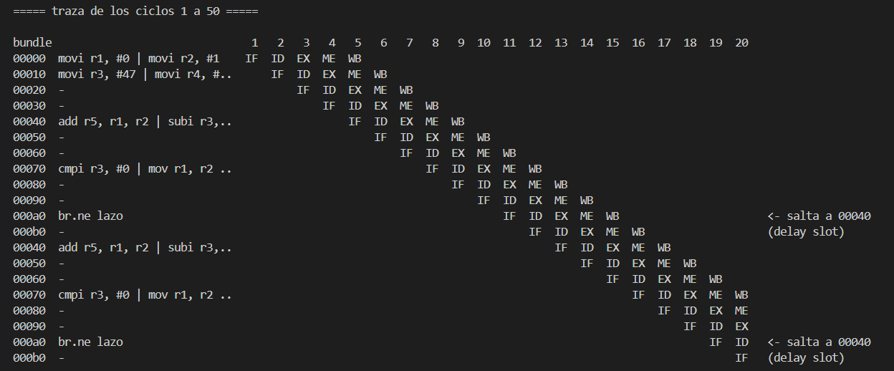
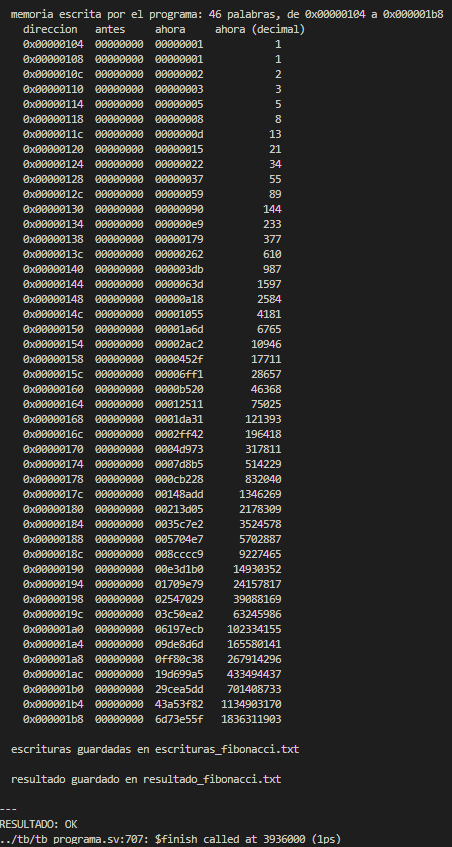
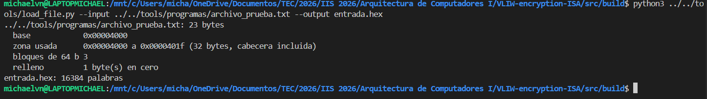
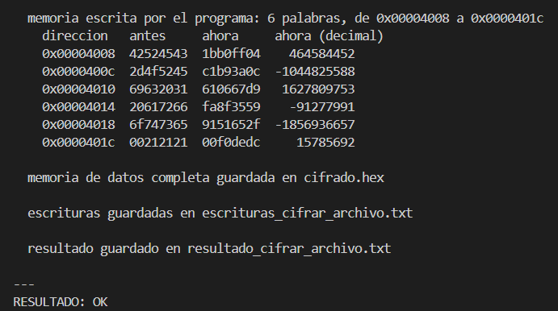
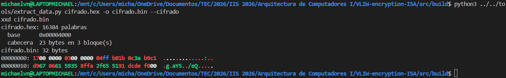
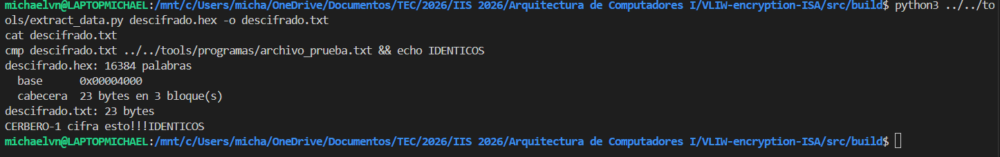

# Simulación de CERBERO-1

Este documento explica cómo se simula el procesador, con qué herramientas, cómo se comprueba que funciona, qué prueba cada testbench y cómo correr un programa propio y revisar lo que hizo.

Un testbench es un archivo de SystemVerilog que no forma parte del procesador: lo rodea, le da entradas, le mueve el reloj y revisa sus salidas. El procesador se ubica en `src/cpu/` y los testbenches en `src/tb/`.

---

## 1. Herramientas

| Herramienta | Para qué se usa |
| :--- | :--- |
| **Icarus Verilog 12** (`iverilog`, `vvp`) | Compila y ejecuta la simulación. Se usa con `-g2012` (SystemVerilog 2012) |
| **Verilator** | Solo análisis estático (`make lint`): revisa el código sin simularlo, buscando señales sin usar, anchos que no coinciden, etc. |
| **GTKWave** | Abre las formas de onda (`.vcd`) para ver cada señal ciclo a ciclo |
| **Python 3** | El ensamblador, la herramienta de carga de archivos, el modelo de referencia de Feistel4 y las pruebas de esas herramientas |
| **make** | Une todo lo anterior. Todos los comandos se corren desde `src/build/` |

La simulación es funcional: comprueba que cada ciclo el procesador haga lo correcto, pero no modela tiempos de compuertas ni retardos reales del hardware.

---

## 2. Cómo se modela el procesador

### 2.1 Reloj y reset

Cada testbench genera el reloj con un período de 10 ns (`always #5 clk = ~clk`) y mantiene el reset (`rst_n`, activo en bajo) durante unos ciclos antes de soltarlo. Desde ahí el procesador corre solo: busca el bundle en `0x0000` y avanza hasta que ejecuta `HALT`.

### 2.2 Cómo entra un programa

El procesador no sabe leer archivos. Sus dos memorias (`imem.sv` e `dmem.sv`) son arreglos que se llenan antes de soltar el reset:

1. El ensamblador (`tools/cerbero_asm.py`) convierte el programa `.s` en un
   `.hex`: una línea por bundle, 32 dígitos hexadecimales. Si el programa
   tiene una sección `.data`, genera también un `.hex` de datos, con una
   palabra de 32 bits por línea.
2. El testbench carga esos archivos con `$readmemh`, la instrucción de
   SystemVerilog que lee un archivo hexadecimal y llena un arreglo con él.

Hay dos formas de llegar a las memorias:

- **Por referencia jerárquica**: el testbench escribe directamente en el
  arreglo interno, por ejemplo `dut.u_imem.storage`. Es lo que usan casi todos
  los testbenches del procesador completo.
- **Por macro**: `tb_asm.sv` y `tb_div.sv` reciben el nombre del `.hex` como
  macro de compilación (`CERBERO_IMEM_FILE`). Se hace así porque Icarus 12 no
  puede pasarle un parámetro de tipo texto a un submódulo.

### 2.3 Cómo se observa

`top.sv` saca tres señales solo para observarlo desde afuera: `halted` (llegó a `HALT`), `psw` (el registro de estado) y `dbg_regs` (los 16 registros). Para la memoria de datos, el testbench lee su arreglo interno por referencia jerárquica, o la vuelca completa a un archivo con `$writememh`.

---

## 3. Cómo se sabe que algo funciona

Todos los testbenches son autoverificables: no basta con que la simulación corra, cada uno compara lo que obtuvo contra lo que debería obtener y lo imprime como `ok` o `PASS`. Si algo no coincide, el testbench llama a `$fatal`, la simulación termina con error y `make` se detiene ahí. Por eso, cuando `make sim` termina bien, significa que todas las pruebas pasaron, no
solo que corrieron.

Hay una regla que se sigue en todos ellos: los valores esperados se calculan fuera del simulador, a mano o con un programa aparte. El testbench nunca recalcula el resultado con la misma fórmula que el módulo, porque si la fórmula
estuviera mal, el módulo y la prueba se equivocarían igual y el caso pasaría.

Para el cifrado, la referencia es un modelo de Feistel4 escrito en Python (`tools/probar_flujo.py`), copiado del pseudocódigo del enunciado. El hardware cifra, Python descifra lo que cifró el hardware (y al revés), y el archivo tiene que volver idéntico byte por byte.

---

## 4. Qué se prueba

Las pruebas suben de nivel: primero cada pieza sola, después las fronteras del pipeline, después el procesador completo corriendo programas, y al final el flujo de un archivo de principio a fin.

### 4.1 Cada unidad por separado

| Testbench | Qué comprueba |
| :--- | :--- |
| `tb_alu.sv` | Las operaciones de la ALU, en las dos instancias (S0 y S1). Solo S0 escribe banderas, y una comparación en S1 es inválida |
| `tb_short_alu.sv` | Las operaciones de la ALU corta y sus combinaciones inválidas |
| `tb_lsu.sv` | Dirección efectiva, extensión de signo, máscara de bytes, postincremento, y las fallas `MISALIGN` y `RANGE` |
| `tb_bru.sv` | Las ocho condiciones de salto, los destinos, el enlace en `r15` y `HALT` |
| `tb_dispatch.sv` | Que el bundle se separe bien en sus cinco slots y que cada puerto del banco lea el registro correcto |
| `tb_regfile.sv` | Banco de registros: escritura en flanco de subida, lectura en flanco de bajada, prioridad entre puertos |
| `tb_key_vault.sv` | La bóveda: cada operación, cada falla, el cierre automático de sesión y las decisiones de implementación |
| `tb_crypto_unit.sv` | La ronda Feistel4, con un modelo simple de la bóveda (`key_vault_model.sv`) |
| `tb_psw_fault_unit.sv` | El PSW: qué falla queda registrada, que la primera no se pierda, y la detección de `WCONF` |
| `tb_imem.sv`, `tb_dmem.sv` | Que las memorias lean y escriban en el flanco correcto y respeten la máscara de bytes |
| `tb_fetch.sv` | El contador de programa: avance, saltos y `HALT` |

### 4.2 Las fronteras del pipeline

| Testbench | Qué comprueba |
| :--- | :--- |
| `tb_reg_if_id.sv`, `tb_reg_id_ex.sv`, `tb_reg_ex_mem.sv` | Que cada registro de segmentación retrase todo exactamente un ciclo y no cruce un campo con el de al lado |
| `tb_latency.sv`, `tb_pipeline.sv` | Que un resultado se pueda leer exactamente 3 bundles después, midiendo sobre los registros reales |
| `tb_fetch_flow.sv` | Búsqueda, memoria y unidad de saltos juntas: exactamente un delay slot, y que `HALT` ejecute el suyo antes de detenerse |
| `tb_crypto_vault.sv` | La bóveda y la unidad Feistel4 juntas: cifrado y descifrado completos contra la referencia, y que las llaves no se puedan leer |
| `tb_wconf.sv` | Que los dos detectores de conflicto de escritura (el del banco y el del PSW) coincidan |

### 4.3 El procesador completo

| Testbench | Qué comprueba |
| :--- | :--- |
| `tb_top.sv` | Programas cortos que ejercitan cada unidad dentro del procesador. Busca errores de cableado: un operando conectado al puerto equivocado, una falla que llega un ciclo tarde |
| `tb_asm.sv` | Que el binario que produce el ensamblador (`feistel.s`) cifre bien al correr en el procesador |
| `tb_div.sv` | La subrutina de división `__div32` con seis pares de números, incluida la división entre cero |
| `tb_credencial.sv` | Con la contraseña equivocada no se cifra nada y queda `DENIED` |

### 4.4 Cifrado de archivos

| Testbench | Qué comprueba |
| :--- | :--- |
| `tb_archivo.sv` | El caso más completo: dos procesadores en la misma simulación, uno cifra un archivo y el otro descifra el resultado. El archivo tiene que volver igual, y ninguna subllave puede aparecer en la memoria |
| `tb_cifrado.sv` | Lo mismo con cualquier archivo que se le dé (`make cifrar`, `make solo-cifrar`) |
| `tb_descifrado.sv` | Descifra un archivo cifrado que viene de disco (`make solo-descifrar`) |

### 4.5 Las herramientas en Python

| Prueba | Qué comprueba |
| :--- | :--- |
| `probar_asm.py` | Que el ensamblador produzca el binario correcto y rechace los programas inválidos. Incluye la comprobación de que `cobertura.s` usa el 100 % de las instrucciones |
| `probar_archivos.py` | Que `load_file.py` y `extract_data.py` sean inversas, con los tamaños difíciles: archivo vacío, un byte, un bloque exacto, un archivo que termina en cero |
| `probar_llave.py` | Que la llave dada por consola quede en el orden correcto |

---

## 5. Comandos

Todos se corren desde `src/build/`.

| Comando | Qué hace |
| :--- | :--- |
| `make all` | Todo: pruebas de las herramientas, todos los testbenches y el flujo de archivo completo |
| `make sim` (o solo `make`) | Todos los testbenches (28 suites) |
| `make <unidad>` | Un solo testbench, por ejemplo `make key_vault` corre `tb_key_vault.sv` |
| `make wave-<unidad>` | Abre las formas de onda de esa unidad en GTKWave |
| `make lint` | Análisis estático de todas las unidades con Verilator |
| `make herramientas` | Solo las pruebas de Python |
| `make flujo` | El flujo de archivo completo con el modelo de referencia |
| `make cifrar ARCHIVO=...` | Cifra y descifra un archivo cualquiera y lo compara contra el modelo |
| `make solo-cifrar ARCHIVO=...` | Solo cifra; el archivo cifrado queda en `cifrado_libre.bin` |
| `make solo-descifrar` | Descifra lo que dejó `solo-cifrar` |
| `make correr PROG=...` | Corre un programa cualquiera (sección 6) |
| `make list` | Lista las unidades que tienen testbench |
| `make clean` | Borra lo generado por las simulaciones |

`LLAVE=` cambia la llave de cifrado en `cifrar`, `solo-cifrar`, `solo-descifrar`
y `correr`, sin editar el ensamblador:

```
make solo-cifrar ARCHIVO=../../foto.png LLAVE=A1B2C3D4,11223344,55667788,99AABBCC
```

---

## 6. Correr un programa propio

Los testbenches de las secciones 4.3 y 4.4 traen su programa fijo. Para cualquier otro programa está `tb_programa.sv`, que se usa con `make correr`: carga el programa, lo deja correr hasta `HALT` y muestra cómo quedó todo.

```
make correr PROG=fibonacci
```

### 6.1 Opciones

| Opción | Qué hace |
| :--- | :--- |
| `PROG=` | El programa en ensamblador. Basta el nombre, con o sin `.s`; se busca en `src/build/` y en `tools/programas/` |
| `HEX=` | En lugar de `PROG`, un programa que ya está en binario (`.hex`), por ejemplo uno generado por un compilador. Se carga tal cual, sin ensamblar |
| `MEMORIA=` | Contenido inicial de la memoria de datos, como `.hex` de una palabra por línea. Por ejemplo, el que genera `load_file.py` a partir de un archivo |
| `VOLCADO=` | Guarda la memoria de datos completa al terminar, para sacar un archivo con `extract_data.py` |
| `MOSTRAR=`, `PALABRAS=` | Muestra en pantalla un rango de la memoria: desde qué dirección y cuántas palabras de 32 bits |
| `TRAZA=` | Muestra el pipeline ciclo a ciclo en una ventana: `TRAZA=30` son los ciclos 1 a 30, `TRAZA=100-130` los ciclos 100 a 130 (hasta 500) |
| `CICLOS=` | Tope de ciclos antes de declarar que el programa no terminó (2 000 000 por omisión) |
| `RESULTADO=`, `ESCRITURAS=` | Nombres de los dos archivos de salida (sección 6.2). Vacíos, no se generan |

### 6.2 Qué deja la corrida

En pantalla y en `resultado_<programa>.txt`, el estado final:

- en cuántos ciclos llegó a `HALT`;
- los 16 registros, en hexadecimal y en decimal;
- el PSW, separado en banderas, estado de la bóveda y fallas;
- la memoria que el programa escribió: cada palabra de la memoria de datos
  que terminó distinta de como empezó, con su valor antes y después.

En `escrituras_<programa>.txt`, la historia completa: cada vez que el procesador escribió un registro (en WB) o la memoria (desde la LSU), con el ciclo, el bundle que lo hizo y su instrucción. Es la evidencia de cómo se llegó
al resultado final. Por ejemplo, en Fibonacci:

```
    ciclo  bundle escritura
        5  00000  REG  r1 <- 00000000   r2 <- 00000001     // movi r1, #0 | movi r2, #1
        7  00040  MEM  [00100] <- 00000000                 // add r5, r1, r2 | ... | sw r1, #0(r4) | ...
      ...
      375  00040  MEM  [001b8] <- 6d73e55f                 // add r5, r1, r2 | ... | sw r1, #0(r4) | ...
```

En el ciclo 375 se ve el `sw` que guarda F(46) = 1 836 311 903 en `0x1B8`.

Mientras corre, el ejecutor avisa en qué ciclo sube y baja `AUTH`, y por qué (por ejemplo, "el PC salió de la región segura"), y cuál fue la primera falla, si hubo.

Con `TRAZA=`, se agrega un diagrama del pipeline, con una fila por bundle y una columna por ciclo, y la lista de eventos de esa ventana: registros y memoria escritos, saltos tomados o no, cambios de banderas, de la bóveda y fallas.

### 6.3 Programas de ejemplo

En `tools/programas/`:

| Programa | Qué demuestra |
| :--- | :--- |
| `fibonacci.s` | Calcula F(0) a F(46) y los guarda desde `0x100`. Usa cuatro slots en el mismo bundle |
| `lazo_estres.s` | 100 000 vueltas, con un bundle que ocupa los cinco slots a la vez; unos 900 000 ciclos |
| `sesion_sin_logout.s` | Una rutina segura que vuelve sin `LOGOUT`: `AUTH` baja sola al salir de la región, y un cifrado posterior queda `DENIED` |
| `cifrar_archivo.s`, `descifrar_archivo.s` | El cifrado y descifrado de un archivo cargado en memoria |
| `div32_prueba.s` | La subrutina de división |
| `cobertura.s` | Usa todas las instrucciones del ISA al menos una vez |

### 6.4 Cifrar un archivo

El mismo `make correr` sirve para cifrar y descifrar un archivo cualquiera, en tres pasos: cargar el archivo en la memoria, correr el programa y sacar el resultado de la memoria. El ejemplo completo está en las secciones 7.2 y 7.3.

---

## 7. Pruebas más relevantes

Estas son las corridas que mejor muestran que el procesador funciona. Cada una trae el comando exacto, la salida real (recortada a lo importante) y qué demuestra. Todas se corren desde `src/build/`.

### 7.1 Fibonacci: un programa general

```
make correr PROG=fibonacci.s
```

El programa calcula F(0) a F(46) y los guarda en memoria desde `0x100`, uno por palabra. Al terminar, la salida muestra:


**Qué demuestra:**

- En `0x100 + 4k` queda F(k). El último, en `0x1B8`, es F(46) = 1 836 311 903,
  que se puede comprobar con cualquier tabla de Fibonacci. F(0) = 0 no aparece
  en la lista porque el programa escribió un 0 donde ya había 0.
- El lazo usa cuatro slots en el mismo bundle (ALU-0, ALU-1, LSU y ALU corta) y
  un salto con su delay slot, así que el resultado solo sale bien si el
  paralelismo, la latencia de 3 bundles y los saltos funcionan.

`escrituras_fibonacci.txt` tiene cada escritura, con su ciclo e instrucción.
Por ejemplo, el `sw` que guarda F(46)






### 7.2 Cifrar un archivo

El archivo de prueba es `tools/programas/archivo_prueba.txt`, que contiene el texto `CERBERO-1 cifra esto!!!` (23 bytes).

**Paso 1: cargar el archivo en una imagen de memoria.**

```
python3 ../../tools/load_file.py --input ../../tools/programas/archivo_prueba.txt --output entrada.hex
```




Los 23 bytes ocupan 3 bloques de 64 bits; el último se completa con un byte en cero. La cabecera en `0x4000` guarda el tamaño original para poder quitar ese relleno al final.

**Paso 2: cifrar en el procesador.**

```
make correr PROG=cifrar_archivo MEMORIA=entrada.hex VOLCADO=cifrado.hex
```



**Paso 3: sacar el archivo cifrado de la memoria.**

```
python3 ../../tools/extract_data.py cifrado.hex -o cifrado.bin --cifrado
xxd cifrado.bin
```


**Qué demuestra:**

- La columna "antes" es el texto original: `42524543` son los bytes `C E R B`
  guardados en little-endian. La columna "ahora" es el texto cifrado: ninguna
  palabra quedó igual.
- `AUTH` sube solo dentro de la región segura (`0x7040`) y baja sola cuando el
  programa vuelve a `0x00D0`, sin que nadie ejecute `LOGOUT`.
- `r1` a `r8` terminan en cero: la contraseña y la llave pasaron por esos
  registros para llegar a la bóveda y se borraron después.
- En `cifrado.bin`, los primeros 8 bytes son la cabecera (23 bytes, 3
  bloques), que viaja sin cifrar. El resto es el criptograma.


### 7.3 Descifrar y comparar con el original

**Paso 1: cargar el archivo cifrado.** `--cifrado` le indica que el archivo ya
trae su cabecera.

```
python3 ../../tools/load_file.py --input cifrado.bin --output entrada_cifrada.hex --cifrado
```

**Paso 2: descifrar en el procesador.**

```
make correr PROG=descifrar_archivo MEMORIA=entrada_cifrada.hex VOLCADO=descifrado.hex
```

**Paso 3: sacar el archivo y compararlo con el original.**

```
python3 ../../tools/extract_data.py descifrado.hex -o descifrado.txt
cat descifrado.txt
cmp descifrado.txt ../../tools/programas/archivo_prueba.txt && echo IDENTICOS
```



Lo que se demuestra: el descifrado es la operación inversa exacta del cifrado.
La columna "antes" del descifrado es la columna "ahora" del cifrado, y el resultado son otra vez los bytes originales. `cmp` no encuentra ninguna diferencia, y el archivo sale con sus 23 bytes: el relleno se quitó usando la cabecera.


### 7.4 Todas las pruebas

```
make sim
```

Corre los 28 testbenches, uno detrás de otro. Si cualquier comprobación falla,
la simulación se detiene ahí con error. Cuando todos pasan, termina con:

```
==============================================================
 Todas las unidades pasaron
==============================================================
```

`make all` hace lo mismo y además corre las pruebas de las herramientas en Python y el flujo de archivo completo.


---


## 9. Limitaciones conocidas

| Limitación | Efecto |
| :--- | :--- |
| Icarus 12 no acepta algunas construcciones de SystemVerilog: `continue` y `break` dentro de lazos, `?:` entre cadenas de texto, clases | Los testbenches están escritos sin ellas. Un testbench nuevo que las use no compila |
| `tb_descifrado.sv` y `tb_programa.sv` no entran en `make sim` | Necesitan un archivo o un programa de entrada. Se corren con `make solo-descifrar` y `make correr` |
| La búsqueda de subllaves en memoria tiene un falso positivo | Si la llave tiene alguna subllave en cero, la prueba la "encuentra" en cualquier palabra en cero y reporta error, aunque el hardware funcione bien |
| La traza se limita a 500 ciclos | Para programas largos se elige una ventana con `TRAZA=a-b` |
| `escrituras_<programa>.txt` se corta en 50 000 líneas | Evita archivos de decenas de MB en programas largos. Al final siempre aparece el total real. `ESCRITURAS_MAX=` cambia el tope |
| La simulación es funcional | No mide retardos ni frecuencia máxima; eso requeriría síntesis sobre una FPGA |